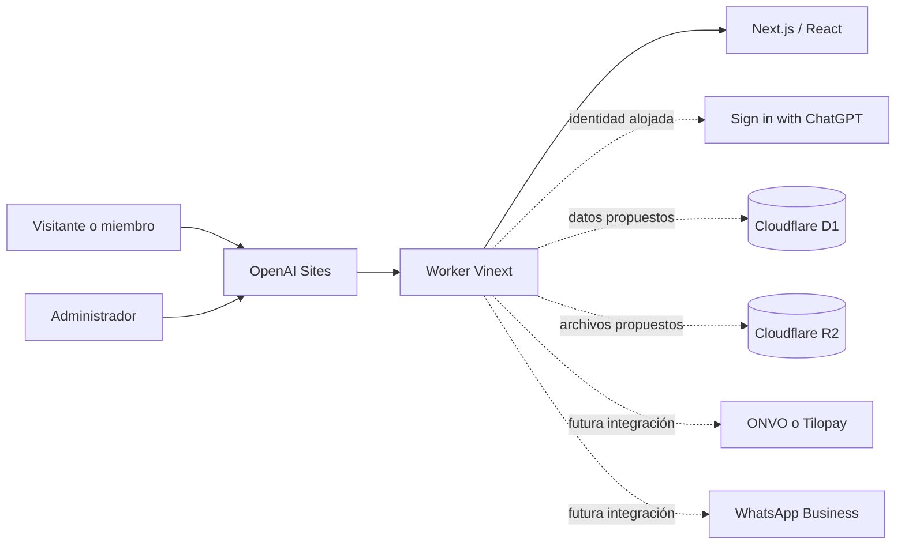

# Arquitectura y decisiones técnicas

## 1. Alcance

El objetivo final es una plataforma editorial con contenido público y premium, denuncias privadas, anuncios, pagos verificados y administración segura. Esta entrega debe entenderse como un **MVP privado de validación**, no como el sistema productivo completo descrito en el brief.

Principios:

- autorización en servidor para toda operación protegida;
- base de datos como fuente de verdad;
- archivos privados con acceso temporal;
- revisión humana antes de publicar denuncias o anuncios;
- integraciones externas desactivadas hasta tener cuentas, contratos y sandbox;
- mínima exposición de datos y trazabilidad de cambios.

## 2. Arquitectura del MVP

| Componente | Responsabilidad | Estado |
| --- | --- | --- |
| Sites | Hosting privado, identidad, despliegues y secretos | Activo para revisión privada |
| Vinext/Worker | Renderizado, rutas y autorización en servidor | Base instalada |
| D1 + Drizzle | Perfiles, roles, contenido, casos, pagos y auditoría | Diseño pendiente; binding aún no habilitado |
| R2 | Evidencias, miniaturas y documentos privados | Diseño pendiente; binding aún no habilitado |
| Proveedor de pago | Checkout, cobros, webhooks y reembolsos | No conectado |
| WhatsApp Business | Orientación y atención autenticada | No conectado |
| Proveedor de video | Reproducción privada mediante tokens o URLs temporales | No seleccionado |

## 3. Identidad

Sites entrega al servidor `oai-authenticated-user-id` y `oai-authenticated-user-email`. El ID es estable para una persona dentro de este Site y debe ser la clave externa durable. El correo es dato de contacto, no clave primaria.

La identidad alojada resuelve el acceso al MVP privado, pero existe una brecha frente al producto solicitado:

- no implementa por sí sola registro con nombre, correo y contraseña;
- no ofrece el flujo comercial de confirmación y recuperación de contraseña pedido en el brief;
- no sustituye una tabla propia de perfiles, roles, sesiones de producto, suscripciones y consentimiento;
- no prueba que una persona sea administradora o miembro premium.

Opciones que debe aprobar el cliente:

1. **Mantener Sites + D1/R2:** menor complejidad para el MVP, identidad administrada y despliegue integrado. Requiere diseñar la experiencia de acceso alrededor de Sign in with ChatGPT.
2. **Adoptar Supabase Auth/Postgres/Storage:** se ajusta mejor al registro tradicional y al ecosistema solicitado, pero introduce otro proveedor, migración de datos, correo, políticas RLS, secretos y costos.
3. **Arquitectura híbrida:** no se recomienda sin una necesidad demostrada, porque duplica identidades y complica la reconciliación.

No se implementará una autenticación casera con contraseñas.

## 4. Modelo de datos propuesto

El esquema debe aprobarse antes de generar migraciones. Entidades mínimas:

- `profiles`: identidad externa estable, datos de contacto y consentimientos;
- `roles`, `permissions`, `profile_roles`: control de acceso;
- `plans`, `subscriptions`: plan, estado, vigencia, renovación y cancelación;
- `payment_transactions`, `payment_events`, `refunds`: importes, monedas, identificadores e idempotencia;
- `investigations`, `videos`, `content_categories`: contenido y programación;
- `complaints`, `complaint_evidence`, `complaint_status_history`: denuncias privadas y trazabilidad;
- `advertisers`, `listings`, `campaigns`, `ad_click_events`: sección comercial y aprobación;
- `notifications`: comunicaciones y estado de entrega;
- `admin_audit_log`: acciones críticas inmutables a nivel de aplicación;
- `provinces`, `cantons`, `districts`: estructura para un catálogo territorial oficial, versionado y autorizado para publicación.

Decisiones de diseño:

- usar UUID/ULID aleatorios; nunca exponer IDs secuenciales sensibles;
- índices por propietario, estado, fecha y claves del proveedor;
- restricciones únicas para evento y transacción del proveedor;
- historial append-only para estados, pagos y auditoría;
- evidencias privadas por defecto; solo guardar metadatos en D1 y objetos en R2;
- separar el código público de seguimiento de la clave interna del caso;
- eliminación lógica cuando la trazabilidad legal lo requiera y borrado efectivo según la política aprobada.

## 5. Límites de autorización

Cada operación protegida debe resolver en el servidor:

1. identidad autenticada;
2. rol y estado de cuenta;
3. pertenencia del registro al usuario o permiso administrativo;
4. estado de suscripción confirmado por base de datos;
5. validación del cuerpo, tamaño y tipo de archivo;
6. registro de auditoría cuando corresponda.

Ocultar un botón no es control de acceso. El cliente nunca decidirá si alguien es premium ni recibirá credenciales de D1/R2, claves secretas o URLs permanentes de video.

## 6. Pagos

ONVO es el candidato inicial por su enfoque en Costa Rica; Tilopay permanece como alternativa. No se ha aprobado ningún proveedor ni se afirma compatibilidad final con recurrencia hasta revisar documentación contractual y técnica vigente.

Antes de implementar se requiere:

- cuenta comercial y condiciones aprobadas;
- credenciales de sandbox;
- documentación oficial de checkout, recurrencia, webhooks, reembolsos y contracargos;
- moneda y precio definitivos;
- política de gracia, vencimiento, reintentos y cancelación;
- definición contable y de facturación.

Flujo obligatorio:

1. crear intento de pago en el backend con importe y moneda esperados;
2. redirigir al checkout seguro del proveedor;
3. tratar la página de retorno solo como información visual;
4. verificar firma, origen, importe, moneda y referencia del webhook;
5. registrar el ID de evento con restricción única;
6. procesar el evento de forma idempotente dentro de una transacción;
7. activar o renovar la membresía solo después de la confirmación del proveedor;
8. reconciliar periódicamente estados dudosos.

Nunca almacenar PAN completo, CVV ni credenciales bancarias.

## 7. Denuncias y evidencias

- Privadas por defecto y visibles únicamente para su propietario y roles autorizados.
- Código de seguimiento independiente del ID interno.
- Estados con historial y motivo: recibida, en revisión, información solicitada, en investigación, cerrada o rechazada.
- Evidencias con cuarentena, validación de firma/tipo real, límite de tamaño, análisis antimalware y descarga autorizada.
- Prohibida la publicación automática. Requiere revisión editorial, minimización de datos, evaluación de interés público y proceso de rectificación.
- Mostrar canales oficiales para emergencias y aclarar que este servicio no reemplaza al 9-1-1, OIJ, Fuerza Pública, Ministerio Público ni otras autoridades.

## 8. Brechas antes de producción

- esquema D1, migraciones y política de retención;
- R2 privado, cuarentena y análisis de archivos;
- roles, MFA administrativa y panel de auditoría;
- autenticación final aprobada;
- proveedor de pago probado en sandbox;
- streaming privado y control de reproducción;
- correo transaccional y WhatsApp Business;
- catálogo territorial de fuente oficial con fecha de actualización y permiso de publicación;
- observabilidad, alertas, límites de abuso y recuperación ante incidentes;
- términos, privacidad, consentimiento y protocolo editorial con revisión legal;
- pruebas de restauración, carga, seguridad y aislamiento.

## 9. Decisiones pendientes

| Decisión | Responsable | Bloquea |
| --- | --- | --- |
| Nombre, dominio y marca | Cliente | Publicación pública |
| Datos de contacto vigentes | Cliente | Contacto y WhatsApp |
| Sites/D1/R2 o Supabase | Cliente + arquitectura | Persistencia y autenticación final |
| ONVO o Tilopay | Cliente + finanzas + legal | Pagos |
| Precio y moneda | Cliente | Planes y checkout |
| Roles y moderadores | Cliente | Administración |
| Política de denuncias y retención | Cliente + asesoría legal | Recepción de datos reales |
| Proveedor de video y correo | Cliente + arquitectura | Premium y notificaciones |

## 10. Procedencia de identidad y activos

Fuentes indicadas o enlazadas por el cliente:

- [Facebook autorizado](https://www.facebook.com/share/1FGcVCAAKb/)
- [Instagram autorizado](https://www.instagram.com/rubenrodriguezoficialdog)
- [Sitio oficial existente](https://rubenrodriguezoficial.com/)

El sitio existente muestra identidad, fotografías, correo y WhatsApp, pero todos esos elementos se consideran **pendientes de confirmación**. Se deben obtener archivos originales y permisos documentados para cualquier tercero visible.
