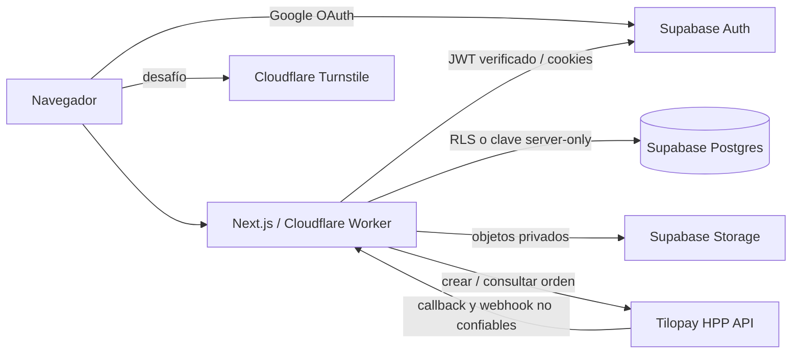

# Arquitectura y decisiones técnicas

## Decisión adoptada

La plataforma usa una arquitectura única para identidad y datos:

Google es el proveedor de inicio de sesión; Supabase administra OAuth, sesiones, Postgres y Storage; Tilopay captura los datos de tarjeta en su Hosted Payment Page. No se usa una segunda identidad ni D1/R2 para datos de producto.

## Límites de confianza

| Componente | Responsabilidad | No puede decidir |
| --- | --- | --- |
| Navegador | Presentación, formularios y token Turnstile | Rol, propiedad, importe, moneda, estado de pago o acceso premium. |
| Google | Identidad OAuth | Roles, membresía o acceso a registros. |
| Supabase Auth | Sesión y claims de autenticación | Autorización de negocio fuera de RLS/RPC. |
| Worker | Validación, autorización, cifrado, integración de pagos y auditoría | Confiar en entrada del navegador, callback o webhook. |
| Supabase Postgres | Fuente de verdad, RLS, constraints y funciones atómicas | Exponer filas sin una política. |
| Supabase Storage | Objetos privados | Servir evidencia sin autorización y auditoría del backend. |
| Tilopay | HPP y confirmación del proveedor | Elegir importe, usuario o membresía local. |

## Identidad, sesión y roles

- El inicio de sesión se inicia en `/auth/sign-in` y regresa a `/auth/callback` usando PKCE de Supabase SSR.
- El backend obtiene el usuario con `auth.getUser()`, no con un valor de UI ni con una sesión sin verificar.
- Las cookies de autenticación son `HttpOnly`, `SameSite=Lax`, `Path=/` y `Secure` en producción.
- El trigger sobre `auth.users` crea `profiles` y asigna el rol básico `member`; el correo no es la fuente de autorización.
- Los roles `admin`, `moderator` y `finance` requieren un JWT con `aal2` y una fila de control no suspendida. Asignarlos es una operación administrativa, no una allowlist de correos.
- No hay contraseñas locales. Si se habilita email/contraseña, el hash, verificación y recuperación siguen siendo responsabilidad de Supabase Auth.

## Datos y acceso

La migración `0001_security_foundation.sql` crea perfiles, roles, planes, precios, suscripciones, pagos, denuncias, evidencias, catálogos, auditoría y límites de tasa. Para todas las tablas de aplicación habilita y fuerza RLS.

- Las claves publishable/anon solo leen catálogos y filas autorizadas por las políticas.
- Las mutaciones delicadas cruzan RPCs acotados; la base deriva `owner_id`, códigos de seguimiento, timestamps, estados y límites en lugar de aceptar esos campos del cliente.
- La clave server-only se usa solo en rutas de backend para auditoría, límites, conciliación, metadatos de evidencias y URLs firmadas.
- Las consultas usan el cliente parametrizado de Supabase; no se construye SQL concatenando texto de usuario.
- Los RPC `my_*` devuelven resúmenes mínimos, sin cifrado, notas internas ni identificadores de proveedor.

## Denuncias y archivos

El formulario exige usuario autenticado, origen propio, Turnstile, límite de tasa y un esquema estricto. El texto sensible y nombres originales se cifran con AES-256-GCM antes de llegar a Postgres. El sobre incorpora versión, nonce aleatorio y AAD que ata el propósito de cifrado.

Una evidencia se acepta solo si cumple tamaño, tipo declarado y firma binaria real. El objeto recibe una ruta UUID opaca en el bucket privado `complaint-evidence`. Queda `pending` hasta que un escáner externo la marque `clean`; solo después el backend autoriza, registra el acceso y expide una URL firmada de 60 segundos.

## Pagos y membresías

1. El usuario autenticado completa un formulario de facturación y Turnstile.
2. El servidor obtiene plan, precio y moneda de `plan_prices`; el navegador no los puede enviar.
3. Se persiste una orden Tilopay única antes de solicitar la URL HPP.
4. El navegador solo recibe una URL HTTPS validada bajo `tilopay.com`.
5. Callback y webhook se almacenan como una huella deduplicada; no se guarda el cuerpo ni datos de tarjeta.
6. El backend consulta `/api/v1/consult` con credenciales propias y compara orden, importe y moneda.
7. Solo entonces marca la transacción aprobada y llama a `grant_tilopay_membership`.
8. Esa función server-only enlaza la transacción a una suscripción y concede un mes de manera idempotente y serializada.

El flujo implementado es un cobro único que da un mes de acceso, no renovación automática. Reembolsos, contracargos y recurrencia requieren reglas adicionales antes de comercializarlos.

## Defensa en profundidad

- Validación Zod, normalización, listas permitidas, límites de cuerpo y rechazo de campos duplicados/desconocidos.
- Turnstile y rate limiting atómico por operación, usuario e IP pseudonimizada.
- CSP, HSTS, `X-Content-Type-Options`, `X-Frame-Options`, COOP, CORP, `Permissions-Policy` y cache privado en rutas sensibles.
- Auditoría append-only de mutaciones y accesos sensibles, con datos minimizados y HMAC para IP/User-Agent.
- CI con escaneo de secretos históricos, `npm audit`, lint y build; Dependabot abre actualizaciones.

## Pendiente para producción

- Aplicar la migración y realizar pruebas RLS con cuentas de prueba independientes.
- Configurar Google OAuth, dominios/redirect URLs, Turnstile y secretos en el entorno alojado.
- Cargar catálogos con licencia compatible y contratar/operar el análisis antimalware.
- Obtener de Tilopay la especificación de `OrderHash` y webhook, probarla y añadir su validación criptográfica.
- Definir legalmente retención, términos, privacidad, soporte, reembolsos y contracargos.
- Verificar respaldos/restauración, monitoreo y respuesta a incidentes antes de abrir el sitio.
